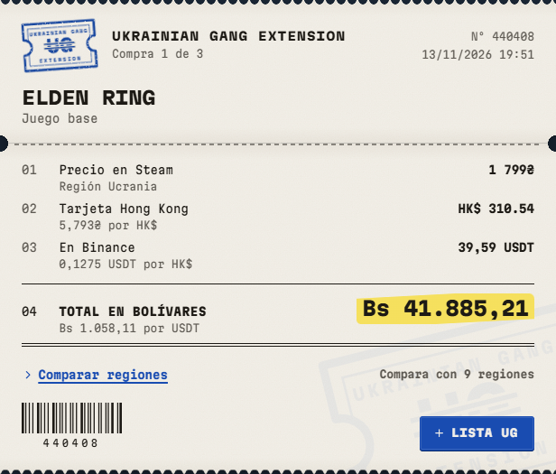
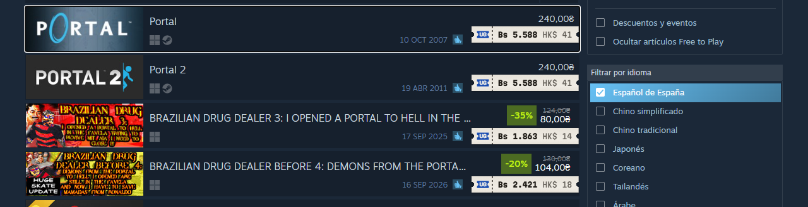
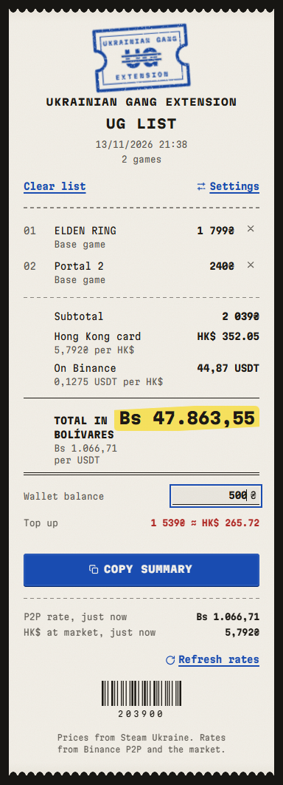
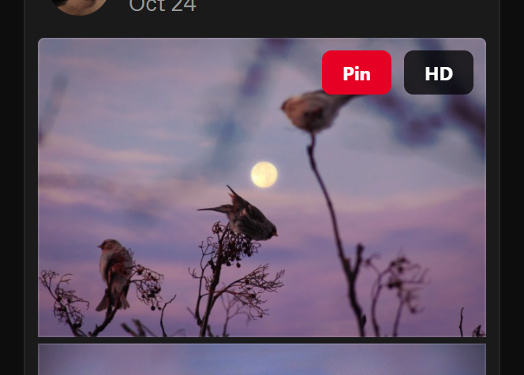

# dau-extensions

Personal browser extensions. Each one lives in its own folder under `extensions/` and is loaded in Brave, Chrome, Edge or Opera as an unpacked extension.

| Extension | What it does | State |
|-----------|--------------|-------|
| [`steam-precios-ug`](extensions/steam-precios-ug/) | **Ukrainian Gang Extension.** Steam Ukraine prices in HK$, USDT and bolívares at the Binance P2P rate, with a receipt per edition, a region comparison and the Lista UG for the group. UI in Spanish. | In use, v0.1.2 |
| [`tumblr-no-wall`](extensions/tumblr-no-wall/) | Removes Tumblr's "Sign up or log in" wall, restores scrolling and adds an HD viewer and a Pinterest button. | In use, v1.2.1 |

| | |
|---|---|
|  |  |
| A receipt under every edition, with the price in ₴, HK$, USDT and Bs | A stub next to every paid price in search and in lists |
|  |  |
| The Lista UG with the total, the wallet and the summary for WhatsApp | Tumblr without the login wall, with the HD and Pin buttons |

## Install an extension

1. Open `brave://extensions` (or `chrome://extensions`, `edge://extensions`).
2. Turn on **Developer mode**.
3. Click **Load unpacked** and pick the extension's folder, for example `extensions/tumblr-no-wall`.
4. After changing the code, click the extension's reload button and refresh the page.

If an extension has a build step, its own README says which folder to load.

> If `tumblr-no-wall` was already loaded from its old path (`Desktop\Development\tumblr\tumblr-no-wall`), the browser shows an error. Remove it and load it again from `extensions/tumblr-no-wall`.

## Development

Node 24 is needed for the tests and the tools; the extensions themselves do not need it.

```
node tools/check-manifests.mjs         # checks every extension's manifest

cd extensions/steam-precios-ug
npm install
npm test                               # unit tests
npm run test:live                      # against the real APIs
npm run test:e2e                       # the extension in Chrome on Steam
```

GitHub Actions checks the manifests and runs the unit tests on every push to `main` (see `.github/workflows/tests.yml`).

### Adding an extension

1. Create `extensions/<name>/` with its `manifest.json` (Manifest V3, version `0.1.0`) and its `README.md`. The README says what it does, how to install it and what it relies on to detect things on the page.
2. If it has logic worth testing, add a `package.json` with `npm test` and add it to the workflow's matrix.
3. Follow [`AGENTS.md`](AGENTS.md): minimal permissions, requests in the service worker, UI isolated in Shadow DOM or prefixed, English in the code and docs.
4. Add it to the table above.

## Layout

```
dau-extensions/
├── extensions/          one folder per extension, each self-contained
├── archive/             old versions and experiments that are no longer used
├── tools/               repo-wide tools
├── .github/workflows/   continuous integration
├── .opencode/skills/    interface design skills (jakubkrehel/skills, MIT)
└── AGENTS.md            conventions for coding agents
```

## Design skills

`.opencode/skills/` holds a copy of [jakubkrehel/skills](https://github.com/jakubkrehel/skills) for interfaces: UI, color, typography, layout, accessibility, writing and review. OpenCode loads them only when this project is open. The exact commit is in `.opencode/skills/SOURCE`.
