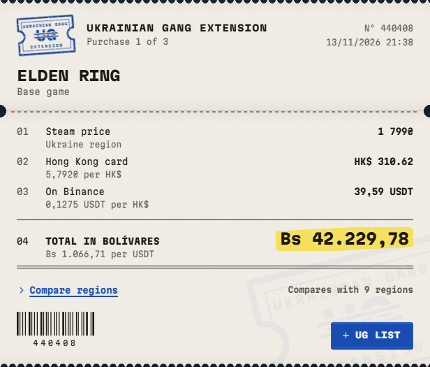
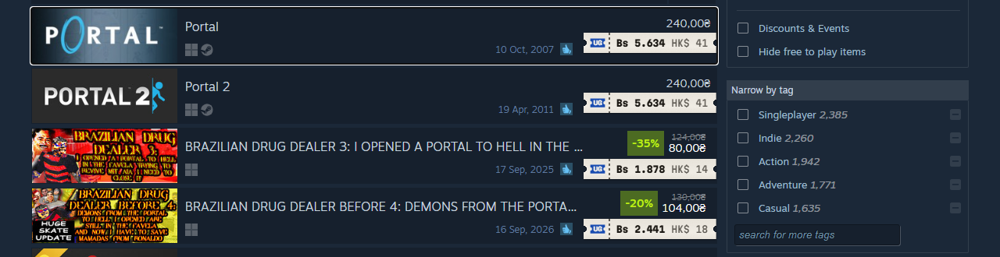
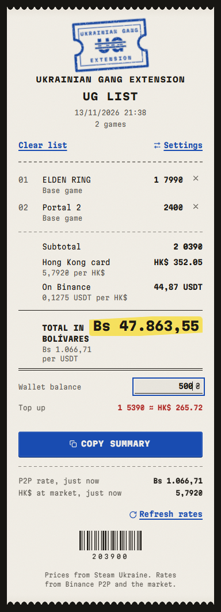
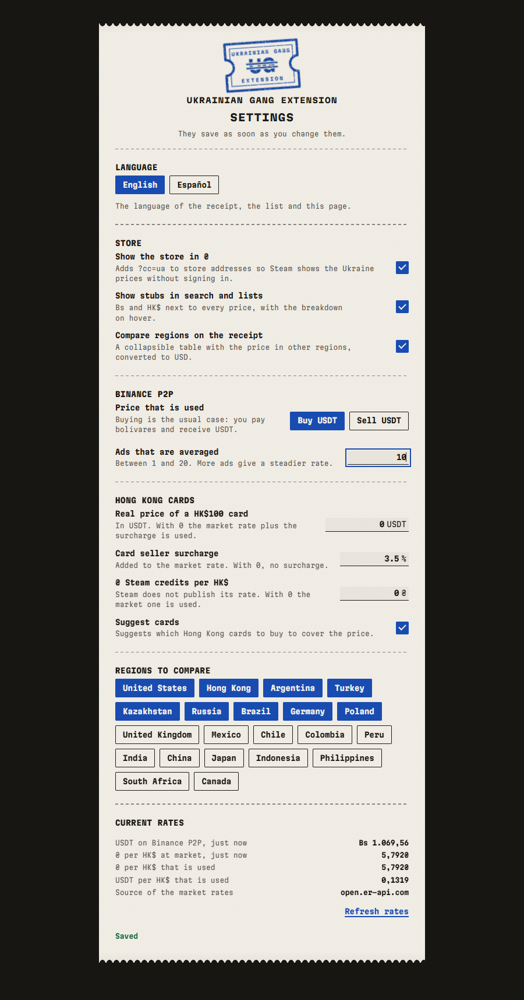
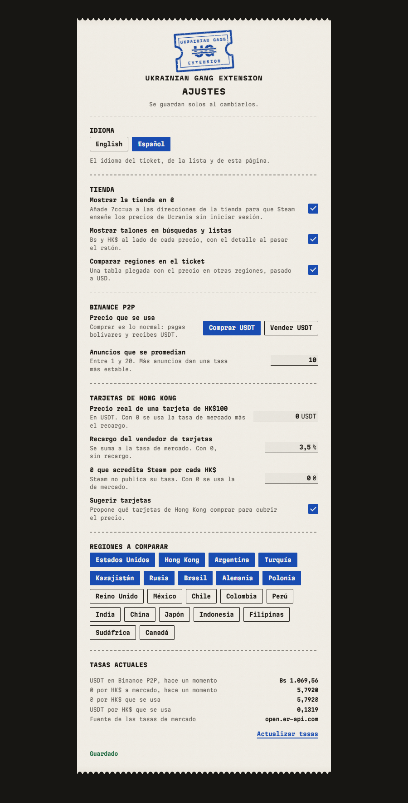

# Ukrainian Gang Extension (steam-precios-ug)

A browser extension for the **Ukrainian Gang** Steam family group. They live in Venezuela and their Steam accounts are set to the Ukraine region, so they pay for Hong Kong Steam gift cards with USDT bought on Binance P2P with bolívares. Next to every store price, the extension shows what it costs in ₴, in HK$ (to know which gift card to buy), in USDT and in bolívares at the Binance P2P rate.

Version 0.2.0. Works on `store.steampowered.com`, without signing in and with any VPN. **The UI is in English by default, with Spanish in the settings page**, because the people who use it speak Spanish.

| Game page | Search results | Shopping list |
|-----------|----------------|---------------|
|  |  |  |

## What it does

- **A receipt on every game page.** Under each purchasable edition (base game, deluxe, bundle, subscription…) a printed-looking receipt shows four lines: the Steam Ukraine price, the Hong Kong gift card amount, the USDT on Binance and the total in bolívares. Each line says which rate it used.
  - Discounts look like a shop receipt: the normal price struck through and a red discount line.
  - **Compare regions** opens a table with the price in the chosen regions, converted to USD and compared with Ukraine.
  - **UG list** adds the edition to the shopping list.
  - Subscriptions (such as GTA+) say "per month" and are not compared across regions. Packages with other games take their own name and say how many games they include.
  - When a page has several purchasable blocks, each ticket is numbered ("Purchase 2 of 3"), because each one is a separate purchase. Only the first keeps the full letterhead; the rest use a shorter header, so the page is not a stack of identical headers.
  - When a rate could not be refreshed, the receipt says so and keeps the last known one. It also has states for a free game, one not sold in Ukraine, one without data and a Steam error.
- **Stubs in search results and lists.** In search, on the front page and in each game's DLC list, every paid price gets a stub with Bs and HK$. Hovering it, or focusing the row with the keyboard, shows the full breakdown.
- **Popup with the UG list.** The shopping list as a long receipt, with the total in ₴, HK$, USDT and Bs. Prices refresh when it opens.
  - With the wallet balance typed in, it says how much is left to top up or how much is left over.
  - **Copy summary** copies a line for WhatsApp or Discord: `ELDEN RING 1 799₴ + Portal 2 240₴ = 2 039₴ ≈ HK$ 381 ≈ 50,5 USDT ≈ Bs 54.423`.
  - Removing a game or clearing the list can be undone.
  - The toolbar icon shows how many games are on the list.
- **Store in ₴.** Adds `?cc=ua` to store pages so Steam shows Ukrainian prices. Can be turned off.
- **Settings:**
  - P2P side (buy or sell USDT) and how many ads are averaged;
  - the real price of the HK$100 card and the seller's surcharge;
  - ₴ that Steam credits per HK$;
  - regions to compare;
  - suggest gift cards (off by default);
  - the language: English (default) or Spanish.

| Settings, in English | The same page in Spanish |
|---|---|
|  |  |

## Install

1. Open `brave://extensions` (or `chrome://extensions`, `edge://extensions`).
2. Turn on **Developer mode**.
3. Click **Load unpacked** and pick this folder, `extensions/steam-precios-ug`.

There is no build step: the folder is loaded as is. `node_modules/` is only for the tests and does not affect the extension.

## How it calculates

```
₴ per HK$      = fx.UAH / fx.HKD                     (or the manual value in settings)
USDT per HK$   = (1 / fx.HKD) × (1 + surcharge %)     (or the real price of the HK$100 card ÷ 100)
HK$            = ₴ / (₴ per HK$)
USDT           = HK$ × (USDT per HK$)
Bs             = USDT × average of the first N Binance P2P ads
```

The region comparison converts each price to USD at the market rate. It does not include the cost of buying gift cards for each region.

## Where the data comes from

The service worker (`src/background.js`) makes every request; the content script never talks to other domains.

| Data | Source | Cache |
|------|--------|-------|
| USDT/VES | `POST p2p.binance.com/bapi/c2c/v2/friendly/c2c/adv/search`. Not a documented API | 5 min |
| Exchange rates | `open.er-api.com`, with `currency-api.pages.dev` and `cdn.jsdelivr.net` as fallbacks | 6 h |
| App prices | `store.steampowered.com/api/appdetails?appids=…&cc=ua&filters=price_overview`, 25 per request | 30 min |
| Package prices | `api/packagedetails/?packageids=…&cc=ua`, one at a time because batches return 400 | 30 min |
| Bundle prices | `actions/ajaxresolvebundles?bundleids=…&cc=ua`. Reads `formatted_final_price`, because `final_price` is 0 without a session | 30 min |
| Other regions | The same APIs with another `cc`, only when "Compare regions" opens | 6 h |

When a source fails, the last stored response is used and the UI says how old it is. Prices live in `chrome.storage.session`; rates, the list and settings in `chrome.storage.local`.

## How it reads the page

Steam changes its HTML. When something stops showing up, the fix goes in `src/content/detect.js`.

- **Page type:** the path `/app/<id>`, `/sub/<id>` or `/bundle/<id>`.
- **Purchasable editions:** every `.game_area_purchase_game` with `input[name="subid"]` (package) or `input[name="bundleid"]` (bundle). The receipt goes after `.game_area_purchase_game_wrapper`.
- **Edition name:** the block title, such as `Buy «ELDEN RING Shadow of the Erdtree Edition»`, without the verb and without the "BUNDLE (?)" label. If it starts with the game name (`#appHubAppName`), the receipt takes the game name and the rest is the edition (the base game when nothing is left). Otherwise, as with a package of other games ("Grand Theft Auto: The Trilogy"), the receipt takes the block title and, as edition, how many games it includes, counted from `.package_contents`.
- **Subscriptions:** the block has the `game_area_purchase_game_dropdown_subscription` class or a `.game_purchase_subscription` paragraph with the billing period ("every 1 month(s)").
- **Price on the page:** `[data-price-final]` in cents, but only when the text has `₴`. Otherwise the price comes from the Steam API, so it works the same with a VPN or with the store in another currency.
- **Game pages without editions** (free, unavailable or coming soon): the app price is requested and the receipt goes at the start of `#game_area_purchase`.
- **Lists:** every `.discount_final_price` or `.game_area_dlc_price` inside an element with `data-ds-itemkey` (`App_620`, `Sub_440408`, `Bundle_232`), `data-ds-appid`, `data-ds-packageid` or `data-ds-bundleid`. Prices of 0 or without digits ("Free") get no stub. A `MutationObserver` covers what Steam loads later, such as infinite scroll in search.
- **Known limit:** sale pages built with React, such as `/specials`, do not use `data-ds-*` and get no stubs.

The UI mounts in `<ug-extension-ui>` elements with Shadow DOM, so Steam's styles do not affect it and its own do not leak. The font is registered on the page as `UG Martian Mono`.

## Tests

```
npm install          # first time only
npm test             # calculations, formats, settings and API parsing (no network)
npm run test:live    # the real APIs: Binance, exchange rates and Steam
npm run test:e2e     # the extension in Chrome on the real store
npm run test:all     # all three
```

The end-to-end test uses the installed Chrome; `CHROME_PATH` picks another one, such as Brave. `HEADFUL=1` shows the browser. It runs 39 steps and saves screenshots to `tests/e2e/screenshots/`, covering:

- the `?cc=ua` redirect;
- one receipt per edition, with the figures checked against the calculation;
- the font loading inside the store;
- "UG list" and the toolbar counter;
- the region comparison;
- every receipt state, with Steam and Binance outages simulated;
- stubs and the tooltip with mouse and keyboard, including infinite scroll and the DLC list;
- a page with a subscription and a package of other games (GTA San Andreas);
- the whole popup: wallet, copy summary, undo and empty list;
- the settings page, including invalid values, and switching the language to Spanish and back;
- a narrow screen and Windows high contrast;
- an axe accessibility audit (WCAG 2.2 AA) of the receipt, the popup and the settings page;
- no extension errors in the console.

`npm run docs` rebuilds the images in `docs/` from the latest end-to-end screenshots.

## Files

| File | What it does |
|------|--------------|
| `manifest.json` | Manifest V3. Permissions: `storage` and `declarativeNetRequestWithHostAccess` (for `?cc=ua`). |
| `src/background.js` | Service worker: network, cache, UG list, the `?cc=ua` rules and the toolbar counter. |
| `src/shared/i18n.js` | UI text in English and Spanish, and the current language. |
| `src/shared/config.js` | Default settings, regions and validation. |
| `src/shared/calc.js` | Conversions, currency formats, suggested cards, region comparison and the summary. |
| `src/shared/sources.js` | API URLs and response parsing. |
| `src/shared/icons.js` | Emblem, icons and barcode as SVG. |
| `src/shared/receipt.css` | The "Receipt" design system. |
| `src/content/detect.js` | Reads Steam's HTML. |
| `src/content/render.js` | Receipt and stub. |
| `src/content/content.js` | Runs the page: detects, asks for data and mounts the UI. |
| `src/popup/` | Popup with the UG list. |
| `src/options/` | Settings page. |
| `_locales/` | The extension description, in English and Spanish. |
| `fonts/` | Martian Mono (SIL OFL 1.1). |
| `icons/` | Extension icons, rendered with `npm run icons`. |
| `docs/` | README images, rendered with `npm run docs`. |
| `design/` | Design decisions, the final mockup and the exploration. |
| `tests/`, `tools/` | Tests and development tools. |
| `HANDOFF.md` | The handoff written before the extension was built. |
