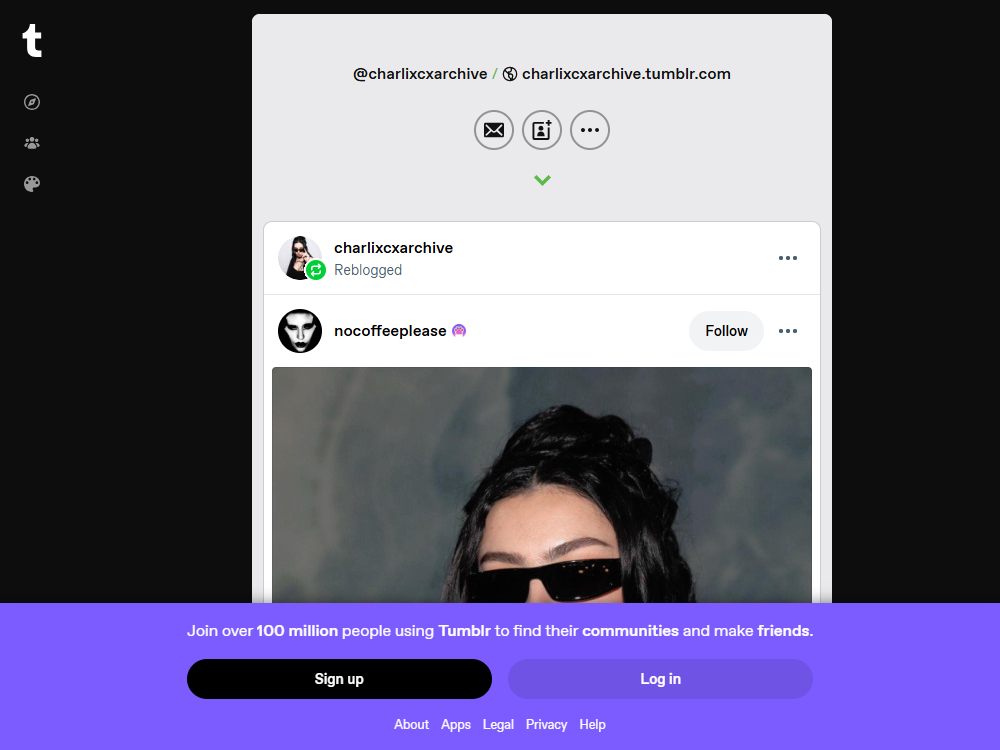
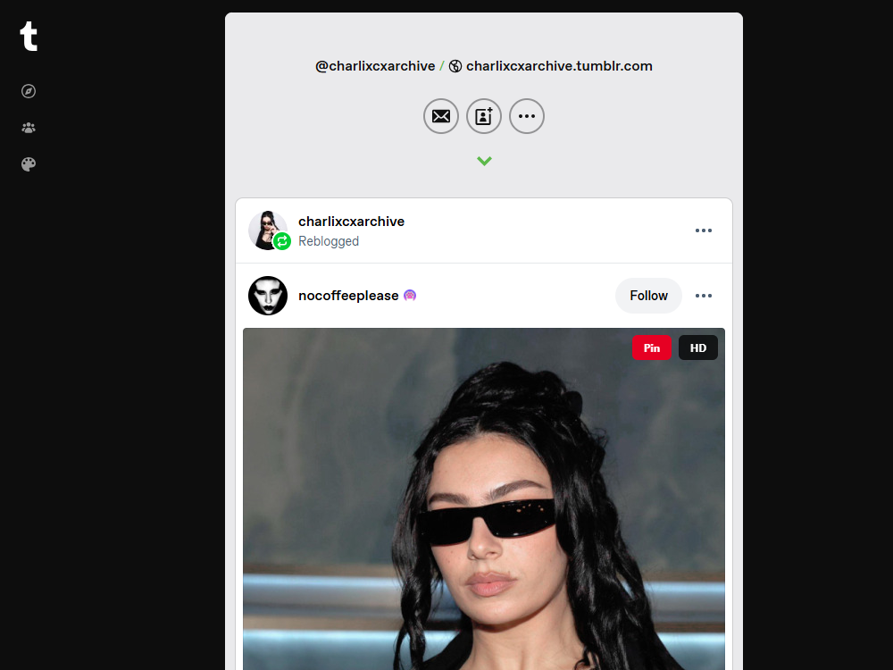
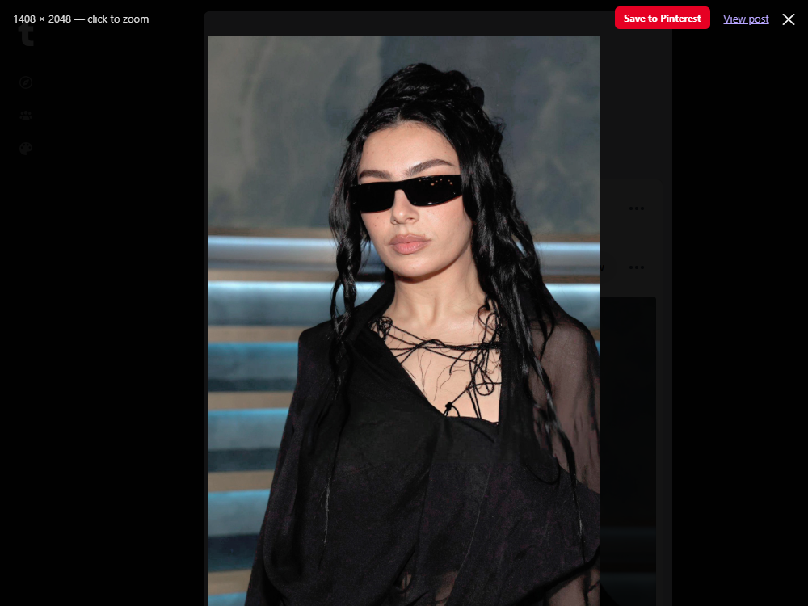

# tumblr-no-wall

Browsing Tumblr without an account.

| Without the extension | With the extension |
|---|---|
|  |  |
| The "Join over 100 million people" bar, over the post | The same post, scrolling, with **Pin** and **HD** on the image |

- Hides the "Sign up or log in" popup and bar and gives scrolling back to the page.
- Hovering an image in a post shows two buttons:
  - **HD** opens a viewer with the largest version Tumblr offers. Click the image to zoom and press `Esc` to close.
  - **Pin** saves the full-size image to Pinterest, linked to the original post, with the blog and the tags as the description.

The HD viewer, with the largest version Tumblr has for the photo:

Version 1.3.0. Works on `*.tumblr.com`. Its few labels follow the browser's language: Spanish for Spanish browsers, English for the rest.

## Install

Load this folder as an unpacked extension (see the repository README).

## Files

| File | What it does |
|------|--------------|
| `manifest.json` | Manifest V3. Injects the scripts at `document_start` without asking for extra permissions. |
| `content.js` | Finds and hides the login wall, and removes the scroll lock and `inert`. |
| `viewer.js` | HD and Pin buttons over images, and the full-screen viewer. |
| `content.css` | Styles for the above, all prefixed `tnw-`. |

## How it detects the wall

Tumblr obfuscates its CSS classes, so the wall is recognised **by its text** (`sign up or log in`, `continue with google`, `regístrate o inicia sesión`). The first `position: fixed` container around that text is hidden, as long as it holds no posts, so an open blog panel is not covered.

If Tumblr changes those texts, update `PHRASES` and `FRAGMENTS` in `content.js`.

## History

`archive/tumblr/inject.json` is an earlier version of the `content.js` script, written for a JS and CSS injector. It does not disable the `<style>` with `overflow: hidden` that the popup brings, so this extension supersedes it.
